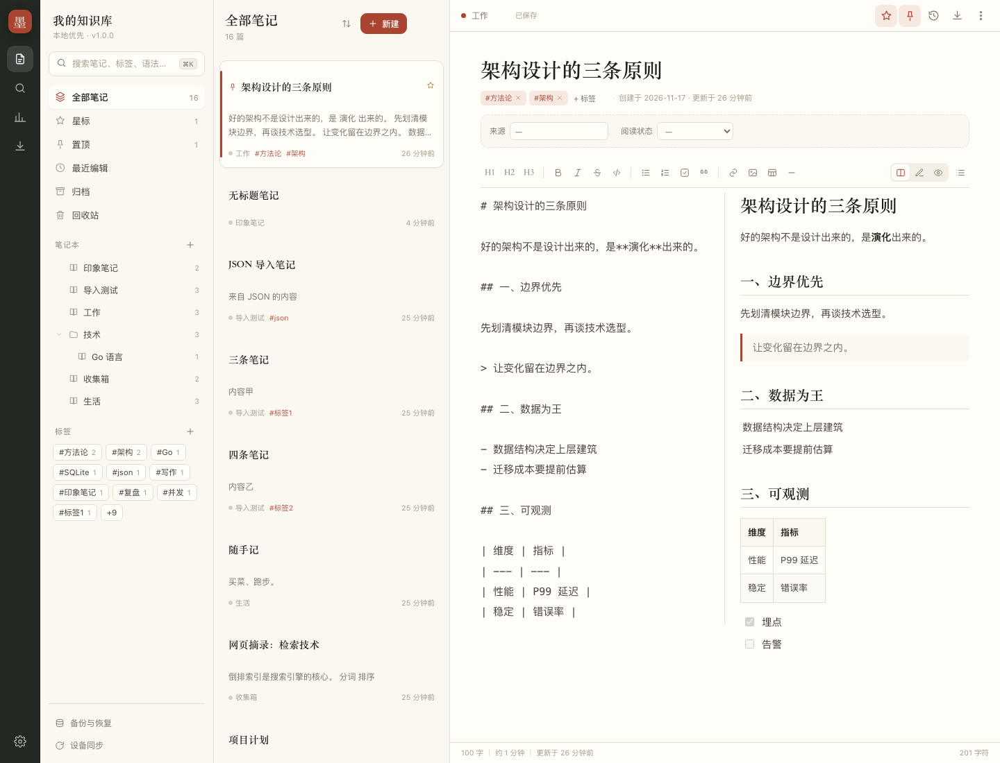
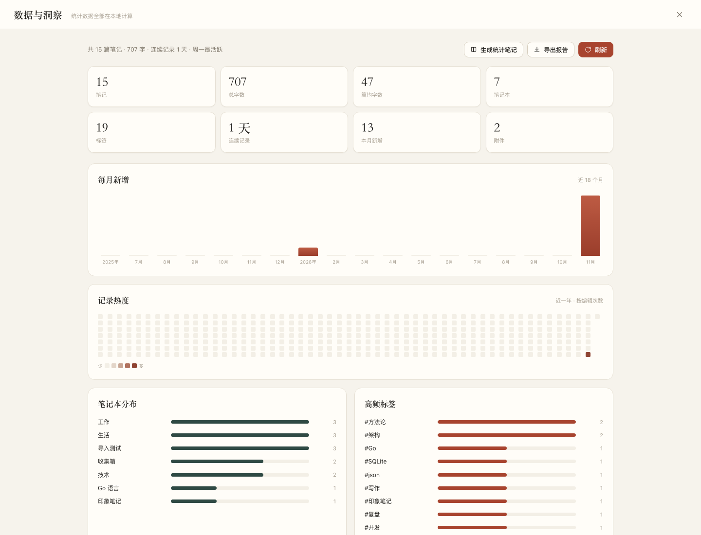
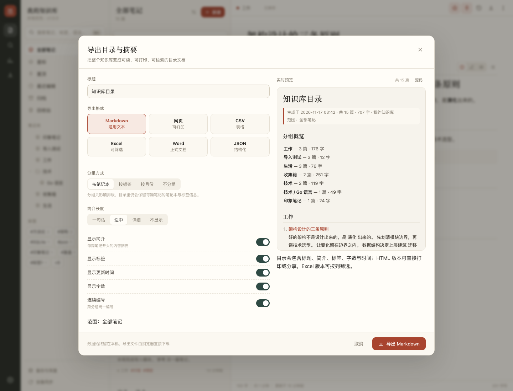
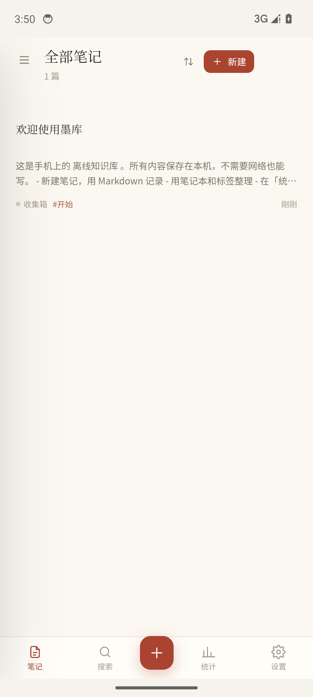
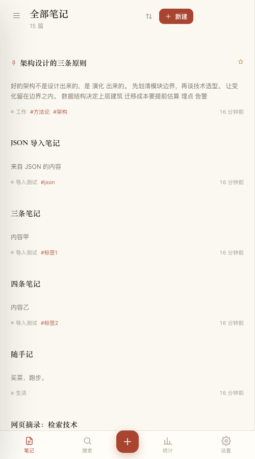

# 墨库 InkVault

> 本地优先的个人知识库：笔记、目录、统计、备份、跨平台，数据始终属于你。



墨库是一个**不需要云账号**的笔记软件。它把数据存在你自己的电脑上，用一个标准 SQLite 文件装下所有笔记，用 Markdown 保存每一篇正文，并且随时可以把整个知识库导出成任何工具都能读的目录树。

## 为什么是它

- **数据完全本地**：SQLite + 附件目录，断网可用，零云端依赖。
- **目录即产品**：一键把整个知识库导出成 Markdown / HTML / CSV / Excel / Word / JSON 目录，带简介、标签、字数、时间、分组与编号。
- **统计能落地**：实时仪表盘、可写入知识库的统计笔记、可导出的 HTML/XLSX/DOCX/CSV 报告。
- **最大兼容**：导入印象笔记 `.enex`、锤子便签 Markdown、Apple 备忘录 HTML、Obsidian/Logseq、Notion、Joplin、CSV/JSON/TXT；导出标准 Markdown、ENEX、DOCX、XLSX、ZIP。
- **跨平台**：macOS / Windows / Linux 单文件服务端，Android APK，iOS 工程，浏览器 PWA。
- **可容纳**：WAL、分页、FTS5 trigram 中文全文检索、附件流式读取，面向十万级笔记设计。
- **可外网**：同一套服务端可直接通过花生壳映射到公网，手机与异地电脑访问同一份数据。

## 截图

| 统计 | 目录导出 |
| --- | --- |
|  |  |

| Android 离线 | 手机列表 |
| --- | --- |
|  |  |

## 快速开始

```bash
# macOS / Linux
./inkvault

# Windows
InkVault.exe
```

浏览器打开 `http://127.0.0.1:8790`。桌面启动会自动打开并登录；手机访问需要输入终端/设置里显示的访问码。

数据目录：

- macOS（.app）：`~/InkVault`
- Windows / Linux：程序旁的 `data/`
- 可用 `-data` 指定任意目录

## 安装包

| 平台 | 文件 |
| --- | --- |
| macOS Apple Silicon | `release/InkVault-1.0.0-macOS-AppleSilicon.dmg` |
| macOS Intel | `release/InkVault-1.0.0-macOS-Intel.dmg` |
| Windows x64 | `release/InkVault-1.0.0-Windows-x64.zip` |
| Android | `release/InkVault-1.0.0-Android.zip`（内含 APK） |
| iOS | `release/InkVault-1.0.0-iOS.zip`（Xcode 工程 + 未签名 IPA） |
| Linux x64 | `release/InkVault-1.0.0-Linux-x64.zip` |
| 源码 | `release/InkVault-1.0.0-Source.zip` |

## 文档

- [使用说明](docs/使用说明.md) —— 安装、写作、分类、检索、导入导出、备份、手机与花生壳
- [设计文档](docs/设计文档.md) —— 架构、数据模型、检索、同步、安全、容量、扩展
- [技术说明](docs/技术说明.md) —— API、数据库、构建、测试

## 技术栈

- Go 1.24 + `modernc.org/sqlite`（纯 Go，无 cgo）
- 原生 HTML/CSS/JS，无前端构建步骤
- FTS5 trigram 中文全文检索
- 自研 DOCX / XLSX 生成器（无第三方 Office 依赖）

## 构建

```bash
go build -o inkvault .
./scripts/build_android.sh     # 需要 Android SDK
./scripts/build_desktop.sh     # macOS / Windows / Linux / 全量发布包
```

## 边界

- 不做实时协作与端到端加密；敏感数据请配合磁盘加密。
- 移动端同步只同步文本与结构，附件保留在电脑端。
- iOS 正式分发需要自己的 Apple 开发者签名。

---

数据能带走，才是真的属于你。
