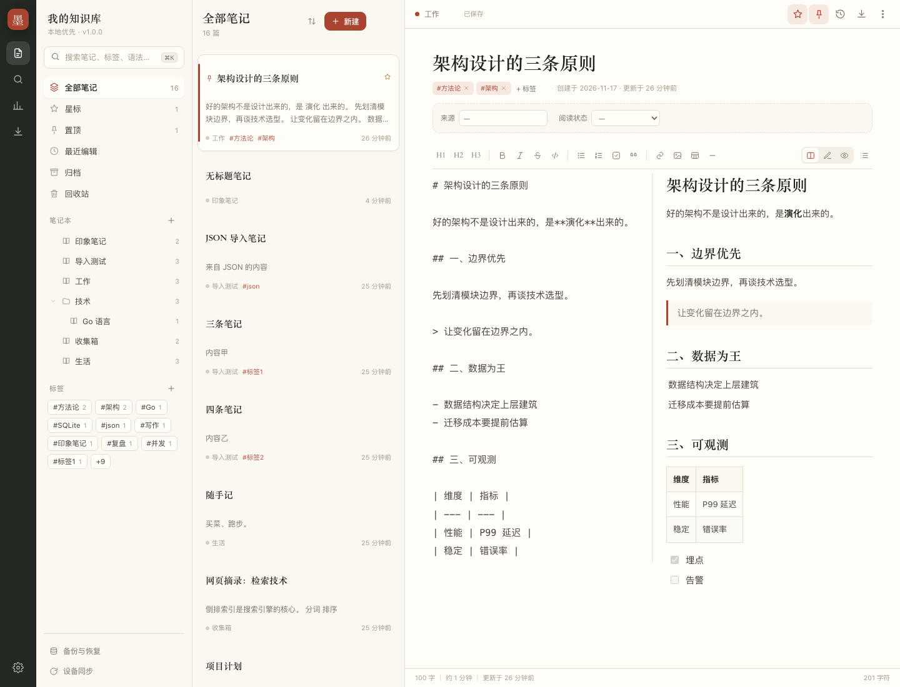
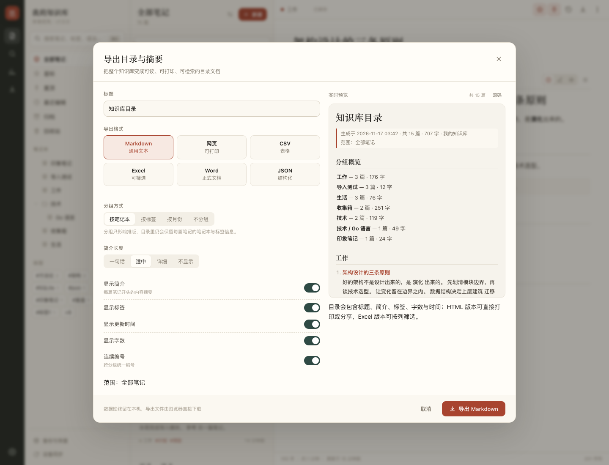
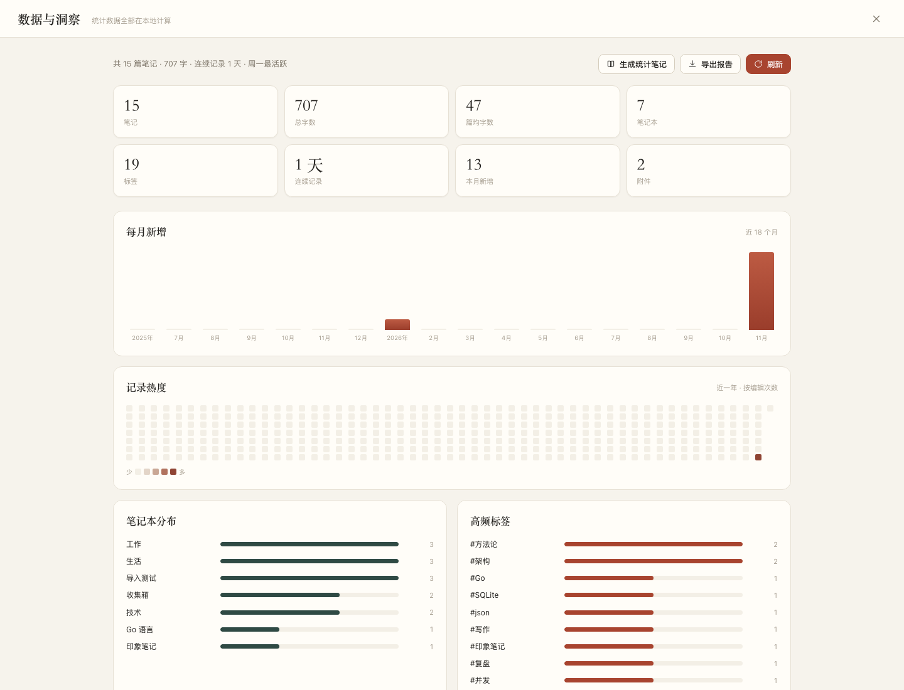

# 墨库 InkVault · 使用说明

> 一份不联网也能用的个人知识库。数据只保存在你自己的电脑和手机里。



---

## 1. 安装与启动

### macOS

1. 打开 `InkVault-1.0.0-macOS-AppleSilicon.dmg`（Intel 机器用 `-Intel.dmg`）。
2. 把「墨库 InkVault」拖进 **Applications**。
3. 第一次启动如果提示「无法验证开发者」：在应用上**右键 → 打开**，或执行：
   ```bash
   xattr -dr com.apple.quarantine /Applications/InkVault.app
   ```
4. 启动后会自动打开浏览器并登录，无需输入访问码。

数据目录：`~/InkVault`（数据库、附件、备份都在这里）。

### Windows

1. 解压 `InkVault-1.0.0-Windows-x64.zip` 到任意文件夹（建议不要放在桌面）。
2. 双击 `启动墨库.bat` 或 `InkVault.exe`。
3. 浏览器会自动打开 `http://127.0.0.1:8790`。
4. 黑色窗口**不要关闭**，它是服务端；访问码显示在窗口里。

数据目录：程序旁边的 `data/`。

### Linux

```bash
chmod +x inkvault
./inkvault
# 或指定数据目录
./inkvault -data ~/InkVault
```

### 安卓

1. 把 `InkVault-1.0.0.apk` 传到手机，点击安装（需允许「安装未知来源应用」）。
2. 首次启动可以选择：
   - **直接开始（离线模式）**：数据存在手机本地，不需要电脑；
   - **连接电脑**：填写电脑地址（如 `192.168.1.10:8790`）和访问码。

### iPhone / iPad

- **有 Mac**：打开 `ios/InkVault.xcodeproj`，在 Xcode 的 Signing 里选择你的 Apple ID，连接手机运行。
- **侧载**：用 Sideloadly / AltStore 打开 `InkVault-1.0.0-unsigned.ipa`，用你的 Apple ID 重新签名后安装。

---

## 2. 界面导览

```
┌────┬──────────────┬──────────────┬──────────────────────────────┐
│ 图 │ 笔记本 / 标签 │   笔记列表    │           编辑器              │
│ 标 │ 导航          │   搜索/筛选   │   标题 / 标签 / 正文 / 预览     │
│ 栏 │              │              │                              │
└────┴──────────────┴──────────────┴──────────────────────────────┘
```

- **左侧图标栏**：笔记、搜索、统计、导入、设置。
- **侧栏**：全部笔记、星标、置顶、最近编辑、归档、回收站；下面是笔记本树和标签。
- **中间列表**：当前范围内的笔记，可按更新时间/创建时间/标题/字数排序。
- **右侧编辑器**：标题、标签、自定义字段、Markdown 正文、实时预览、大纲。
- **窄屏**：自动切换为「列表 → 编辑」两层，底部有导航栏。

### 快捷键

| 快捷键 | 动作 |
| --- | --- |
| `⌘K` / `Ctrl+K` | 打开命令面板（搜索/命令） |
| `⌘N` | 新建笔记 |
| `⌘S` | 立即保存（平时会自动保存） |
| `⌘E` | 打开目录导出 |
| `⌘B` / `⌘I` | 加粗 / 斜体 |
| `Tab` / `Shift+Tab` | 缩进 / 反缩进 |
| `Esc` | 关闭弹层 |

---

## 3. 写作

### 3.1 新建与保存

- 点击右上角「新建」，或按 `⌘N`。
- 停止输入 **0.8 秒**后自动保存，右上角会显示「已保存」。
- 笔记会自动记录历史版本：点编辑器右上角的时钟图标可以查看、恢复。

### 3.2 Markdown 支持

| 写法 | 效果 |
| --- | --- |
| `# 标题` / `## 二级` | 标题（会出现在右侧大纲） |
| `**加粗**` / `*斜体*` | 强调 |
| `- 列表` / `1. 列表` | 无序 / 有序列表 |
| `- [ ] 待办` | 任务清单 |
| `> 引用` | 引用块 |
| `` `代码` `` / 三反引号 | 行内代码 / 代码块 |
| `[文字](链接)` | 链接 |
| `` | 图片 |
| `\| 表格 \|` | 表格 |
| `==高亮==` | 高亮 |

### 3.3 插入图片

- 直接**粘贴**剪贴板里的图片；
- 或把图片**拖进编辑区**；
- 或点工具栏的图片按钮选择文件。

大于 900 KB 的图片会自动压缩到最长边 2000 px，保持清晰度的同时控制体积。

### 3.4 编辑器视图

工具栏右侧有三个按钮：

- **分屏**：左边写、右边看（桌面默认）；
- **纯编辑**：只显示 Markdown 原文（手机默认）；
- **预览**：只显示排版结果。

再右边是大纲按钮，显示当前笔记的标题结构。

---

## 4. 分类与整理

### 4.1 笔记本

- 点击侧栏「笔记本」右侧的 `+` 新建；
- 悬停笔记本，点右侧 `⋯` 可以：新建子笔记本、重命名、生成目录笔记、导出、删除；
- **删除笔记本不会删笔记**，里面的笔记会移到上级笔记本。

### 4.2 标签

- 在编辑器标签栏输入名称，回车即可添加；
- 点侧栏标签可以筛选；右键标签可以重命名或删除；
- 删除标签只解除关联，不会删笔记。

### 4.3 自定义字段

「设置 → 分类与模板」可以给笔记增加结构化属性，例如：

- 来源（链接）
- 阅读状态（未读 / 在读 / 已读）
- 评分（数字）
- 读完日期（日期）

字段可以限定只作用于某个笔记本。设置后，编辑器的标签下方会出现一行属性输入框。

### 4.4 模板

在「设置 → 分类与模板」里保存模板，例如：

```markdown
# 每周复盘

## 本周做成了什么

## 遇到的问题

## 下周计划
```

之后在命令面板（`⌘K`）输入「模板」，选择模板即可新建一篇带结构的笔记。

### 4.5 回收站

- 删除的笔记会进入「回收站」，可恢复或永久删除；
- 永久删除会同时清理附件和历史版本，请谨慎。

---

## 5. 检索

### 5.1 快速搜索

按 `⌘K` 打开命令面板，输入关键词：

- 回车打开第一条结果；
- 上下键选择；
- 也可以在面板里执行命令（新建、导出目录、统计、导入、备份、设置）。

### 5.2 搜索语法

在命令面板或搜索框里输入：

| 语法 | 示例 | 说明 |
| --- | --- | --- |
| 关键词 | `架构 演化` | 多个词同时满足 |
| `tag:` | `tag:方法论` | 按标签 |
| `#` | `#读书` | 按标签的简写 |
| `notebook:` | `notebook:工作` | 按笔记本 |
| `is:starred` | `is:starred 架构` | 星标笔记 |
| `is:pinned` | `is:pinned` | 置顶笔记 |
| `before:` | `before:2026-01-01` | 更新时间早于 |
| `after:` | `after:2026-01-01` | 更新时间晚于 |

### 5.3 保存搜索

搜索后，列表顶部会出现「保存搜索」按钮。保存后会固定显示在侧栏，适合：

- 待读清单：`tag:待读 is:starred`
- 本月复盘：`after:2026-11-01 复盘`
- 工作笔记：`notebook:工作`

---

## 6. 导出目录与摘要（核心功能）



1. 按 `⌘E`，或点侧栏的「导出目录」入口（命令面板里也有）。
2. 选择格式：

   | 格式 | 适合 |
   | --- | --- |
   | Markdown | 放进 Obsidian、博客、Git |
   | 网页（HTML） | 打印、分享、直接阅读 |
   | CSV | 轻量表格 |
   | Excel（XLSX） | 筛选、排序、透视 |
   | Word（DOCX） | 正式文档 |
   | JSON | 程序处理 |

3. 选择分组方式（笔记本 / 标签 / 月份 / 不分组）。
4. 调整简介长度、是否显示标签/时间/字数/编号。
5. 右侧实时预览，点「源码」可切换看 Markdown 原文。
6. 点「导出」，浏览器直接下载。

**范围**：导出的是**当前筛选范围**——如果你先筛选了某个笔记本或搜索了关键词，目录也只包含这些笔记。

### 自动目录笔记

在笔记本的 `⋯` 菜单里点「生成目录笔记」，会在该笔记本里创建一篇普通笔记，内容是所有笔记的链接与摘要。它的好处是：目录本身也能被搜索、被引用、被再次整理。

---

## 7. 统计与报告



点左侧图标栏的图表按钮，或按 `⌘K` 输入「统计」。

- **KPI**：笔记数、总字数、篇均字数、笔记本、标签、连续记录、本月新增、附件。
- **每月新增**：近 18 个月柱状图。
- **记录热度**：近一年每日编辑次数。
- **分布**：笔记本、标签。
- **最长的笔记**：按字数排序。

右上角可以：

- **生成统计笔记**：把当前统计写成一篇普通笔记（`数据概览 · 2026-11`），可回顾、可搜索。
- **导出报告**：HTML（带图表）、XLSX（6 个工作表）、DOCX、CSV、Markdown。

---

## 8. 导入别家的笔记

点左侧「导入」图标，或 `⌘K` → 导入。支持拖拽文件，也可以点击选择。

### 8.1 印象笔记 / Evernote

1. 在印象笔记客户端选择笔记 → 右键 → **导出笔记** → 格式选 **ENEX**；
2. 把 `.enex` 文件拖进墨库；
3. 导入后：标签、附件、创建时间、来源链接都会保留；
4. 笔记本名称取自文件名（例如 `工作.enex` → 笔记本「工作」）。

### 8.2 锤子便签

1. 在锤子便签网页版使用「导出助手」导出 Markdown 压缩包；
2. 把 zip 拖进墨库；
3. 文件夹结构会变成笔记本，图片会进入附件。

### 8.3 Apple 备忘录

1. 在 macOS 备忘录里选择笔记 → 文件 → 导出为 **HTML**（或导出整个文件夹）；
2. 把 HTML 文件或 zip 拖进墨库；
3. 正文与图片会保留。

### 8.4 Obsidian / Logseq

1. 把整个 vault 文件夹压缩成 zip；
2. 拖进墨库；
3. 保留文件夹层级、frontmatter 里的标签、`[[双链]]` 会转成文字、图片进入附件。

### 8.5 Notion

1. Notion → 设置 → 导出全部内容 → 选择 **Markdown & CSV**；
2. 解压后把 zip 拖进墨库；
3. 页面层级会变成笔记本，CSV 会变成表格笔记。

### 8.6 Joplin

1. 在 Joplin 里导出为 **JEX**；
2. 拖进墨库；
3. Markdown 与资源文件会一起导入。

### 8.7 CSV / JSON / TXT

- CSV 支持列名：`标题/title`、`内容/content`、`标签/tags`、`笔记本/notebook`、`创建时间`、`更新时间`；
- JSON 支持墨库自己的导出格式，也支持 `{ notes: [...] }` 或笔记数组；
- TXT 会作为一篇笔记导入，标题取文件名。

> **导入只增不改**：不会覆盖现有笔记；重复导入会产生副本。

---

## 9. 导出与备份

### 9.1 导出单篇

编辑器右上角「下载」图标，或 `⋯` 菜单：

- Markdown：原文 + YAML 头；
- 网页：图片内嵌，单文件可分享；
- Word：正式排版；
- 纯文本；
- ENEX：迁回印象笔记；
- JSON。

### 9.2 导出整库

「设置 → 备份 → 导出整库 ZIP」，得到：

```
我的知识库/
├── 目录.md / 目录.html
├── 工作/…
├── 生活/…
├── _附件/
├── 数据.json
└── manifest.json
```

可以直接拖进 Obsidian 使用。

### 9.3 备份

「侧栏底部 → 备份与恢复」：

- **立即备份**：生成 `vault/db + 附件 + manifest` 的 zip；
- **下载**：保存到电脑；
- **恢复**：选择备份 → 自动先备份当前数据 → 覆盖 → 重新加载；
- **自动备份**：默认每天一次，保留 14 份（可在设置里改）。

**三层保险**：

1. 自动备份（防误删）；
2. 整库导出（防软件不可用）；
3. 每月把 `vault/` 目录复制到移动硬盘或网盘（防硬盘损坏）。

---

## 10. 手机与外网访问

### 10.1 同一 Wi-Fi

1. 电脑端启动墨库，窗口里会显示「局域网」地址，例如 `http://192.168.1.10:8790`；
2. 手机浏览器打开这个地址，输入访问码；
3. 也可以装 Android App，选择「连接电脑」，填地址和访问码。

### 10.2 花生壳映射到公网

1. 安装并登录花生壳客户端；
2. 新建映射：
   - 应用类型：**HTTPS**（推荐）或 **TCP**；
   - 内网主机：`127.0.0.1`；
   - 内网端口：`8790`；
3. 保存后会得到一个域名，例如 `https://notes.example.vicp.net`；
4. 回到墨库：「设置 → 公网地址」填入这个域名，保存；
5. 手机或外地电脑打开该域名，输入访问码即可。

**安全建议**：

- 访问码改成 8 位以上，不要用生日、手机号；
- 花生壳优先选 HTTPS；
- 不需要外网时，在花生壳里暂停映射；
- 定期看「设置 → 访问日志」，发现陌生 IP 立刻改 PIN 和 Token。

### 10.3 手机离线使用

Android / iOS App 首次启动选「直接开始（离线模式）」：

- 所有内容保存在手机本地；
- 不需要电脑也能写、能搜、能导出目录；
- 需要和电脑合并时：「设置 → 设备与同步」填服务器地址和访问码 → 双向同步。

同步规则：同一篇笔记，**修改时间更晚的版本获胜**；删除也会同步。

---

## 11. 设置

| 分区 | 内容 |
| --- | --- |
| 常规 | 知识库名称、公网地址、主题（纸白/暖黄/墨黑）、字号、编辑区宽度、默认视图 |
| 访问与安全 | 访问码、API Token、是否需要登录、信任代理、强制 HTTPS、会话天数、上传上限 |
| 分类与模板 | 自定义字段、笔记模板 |
| 备份 | 自动备份、保留份数、间隔、数据位置、导出整库、重建索引 |
| 关于 | 版本、数据库路径、快捷键、访问日志、退出登录 |

---

## 12. 常见问题

**Q：数据到底存在哪？**
A：macOS 在 `~/InkVault`；Windows 在程序旁 `data/`；手机在 App 自己的存储里。数据库是标准 SQLite，附件是普通文件。

**Q：换电脑怎么迁移？**
A：复制整个 `vault/`（或 `data/`）目录到新电脑，启动即可。也可以用「导出整库 ZIP」再导入。

**Q：会不会上传到云端？**
A：不会。除非你自己用花生壳把端口映射到公网，否则数据不会离开本机。

**Q：支持多少篇笔记？**
A：设计目标是十万级。SQLite + FTS5 足够支撑；实际瓶颈通常是附件体积。

**Q：为什么手机端没有附件同步？**
A：附件体积大，当前版本优先保证文本与结构的快速同步；附件仍完整保存在电脑端。

**Q：手机能存多少笔记？**
A：Android 的 IndexedDB 容量通常足够几万篇纯文本笔记；iOS 的 WebView 本地存储更保守，建议把手机当作「随身写作与查阅」终端，大库仍以电脑端为准，定期同步。

**Q：手机能存多少笔记？**
A：Android 的 IndexedDB 容量通常足够几万篇纯文本笔记；iOS 的 WebView 本地存储更保守，建议把手机当作「随身写作与查阅」终端，大库仍以电脑端为准，定期同步。

**Q：导入后格式有点乱？**
A：不同软件的 HTML 结构差异很大。可以先试 HTML 导入；如果样式丢失，用 Markdown 导出通常更干净。

**Q：忘记访问码怎么办？**
A：打开 `vault/config.json`（macOS 在 `~/InkVault/config.json`），里面的 `pin` 字段就是访问码。修改后重启服务。

**Q：端口被占用？**
A：启动时加 `-port 8791`（或其它端口）：`./inkvault -port 8791`。

**Q：想在手机上用完整功能（导入 ENEX、导出 Excel）？**
A：用手机浏览器打开电脑端地址（同一 Wi-Fi 或花生壳），就是完整版；App 的离线模式是精简版。

---

## 13. 数据安全清单

- [ ] 开启电脑磁盘加密（macOS FileVault / Windows BitLocker）
- [ ] 每月导出一次整库 ZIP，放到另一块硬盘
- [ ] 访问码 8 位以上，不用弱口令
- [ ] 公网访问优先 HTTPS
- [ ] 定期检查访问日志
- [ ] 重要笔记导出 Markdown 留一份纯文本副本

> 数据能带走，才是真的属于你。
